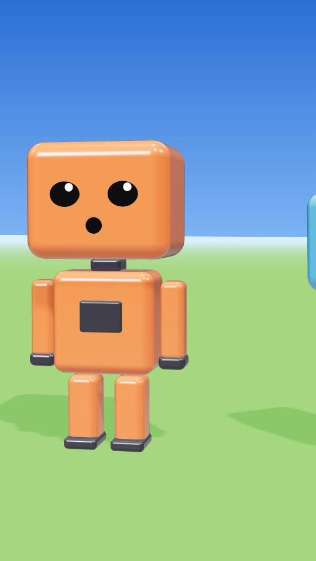

# re-film

Skill [Claude Code](https://claude.com/claude-code) untuk membuat film YouTube (Shorts atau video panjang)
dari ide sampai siap unggah, dengan tokoh robot kotak plastik berkilat dalam dunia 3D.



## Alurnya

1. **Ide.** Claude menanyakan kategori, mencari ide yang berpotensi viral, lalu mengecek YouTube (Indonesia + Inggris).
   Ide yang sudah punya lebih dari 3 video serupa dibuang. Kamu memilih satu, sisanya disimpan di bank ide (`katalog.md`).
2. **Pengaturan.** Durasi (30 dtk / 1 / 3 / 5 / 10 mnt), format (vertikal / horizontal), bahasa suara
   (Indonesia / Inggris), dan bahasa subtitle (boleh beda dari suara).
3. **Cerita & narasi.** Riset di web, cerita dengan hook, twist, dan outro, lalu narasi siap tempel ke
   **Google AI Studio TTS** (adegan bernomor, detik, nada).
4. **Audio.** Kamu kirim hasil TTS-nya. Claude mentranskrip per kata, dan waktu adegan mengikuti audio asli.
5. **Video.** Remotion + three.js: robot BoxBot plastik, aset gratis (Kenney, Quaternius, Poly Haven, …), dan gaya
   visual yang berganti mengikuti tema supaya tidak terasa otomatis. Subtitle mengikuti kata yang diucapkan, dan
   video non-Shorts ≥ 3 menit diberi placeholder end screen 20 detik.
6. **Siap unggah.** Saran judul, deskripsi (dengan bab), tag, dan kategori YouTube.

## Pasang

Di Claude Code:

```
/plugin marketplace add resoftw/re-film
/plugin install re-film@re-film
```

Atau manual: salin folder `skills/re-film` ke `~/.claude/skills/re-film`.

Lalu cukup bilang ke Claude: *"bikin film baru dong"*.

## Kebutuhan

| Alat | Untuk |
|---|---|
| Node.js 18+ | Remotion + three.js (dipasang otomatis sekali di folder kerja lewat `npm install`) |
| Python 3.9+ dan `pip install faster-whisper` | transkrip narasi per kata |
| [yt-dlp](https://github.com/yt-dlp/yt-dlp) | mengecek seberapa ramai ide di YouTube |
| ffmpeg / ffprobe | konversi audio & cek hasil |
| Google Chrome | dipakai Remotion untuk render |

## Isi repo

```
skills/re-film/
  SKILL.md              alur kerja lengkap (dibaca Claude)
  scripts/              yt_check.py (cek YouTube), transcribe.py (transkrip per kata)
  assets/workspace/     dipasang SEKALI di folder kerja: package.json, kit/ (BoxBot, Stage, Glb, Captions, Endscreen)
  assets/film/          kerangka satu film (src/, public/)
  references/           menu gaya visual, sumber aset gratis, panduan metadata YouTube
```

Semua film di folder kerja berbagi `node_modules`, `kit/`, dan `aset/` yang sama, jadi film kedua dan seterusnya
jauh lebih cepat dibuat.

## Catatan

- Aset pihak ketiga tidak disertakan di repo ini. Skill mengunduhnya dari sumber gratis dan mencatat lisensinya di
  `CREDITS.md` tiap film.
- Tokoh BoxBot adalah desain asli dari bentuk-bentuk sederhana (kotak bersudut bulat, plastik mengilap).

## Lisensi

MIT
